# Evidências — pardal batendo as asas e voando em direção ao espectador

Capturas feitas em `vite preview` (build de produção), viewport de 1440 × 900, com Playwright 1.64 e Chromium (canal Google Chrome, WebGL por ANGLE/Metal em um Apple M4). Sem API nem banco: a página inicial renderiza sem eles. O aviso de cookies foi recusado antes de gravar.

## Vídeos

Cada vídeo percorre um momento inteiro: chega antes do gatilho, para no meio do voo por 1,2 s (a página fica parada e o pardal continua batendo as asas) e segue até depois da cortina. Na subida, o mesmo trajeto ao contrário.

| Momento  | Descendo                                   | Subindo                                  |
| -------- | ------------------------------------------ | ---------------------------------------- |
| `#ia`    | [ia-descendo.webm](ia-descendo.webm)       | [ia-subindo.webm](ia-subindo.webm)       |
| `#plano` | [plano-descendo.webm](plano-descendo.webm) | [plano-subindo.webm](plano-subindo.webm) |

## Prints-chave

| Fase                              | `#ia`                                               | `#plano`                                                  |
| --------------------------------- | --------------------------------------------------- | --------------------------------------------------------- |
| Batendo as asas, ainda longe      | 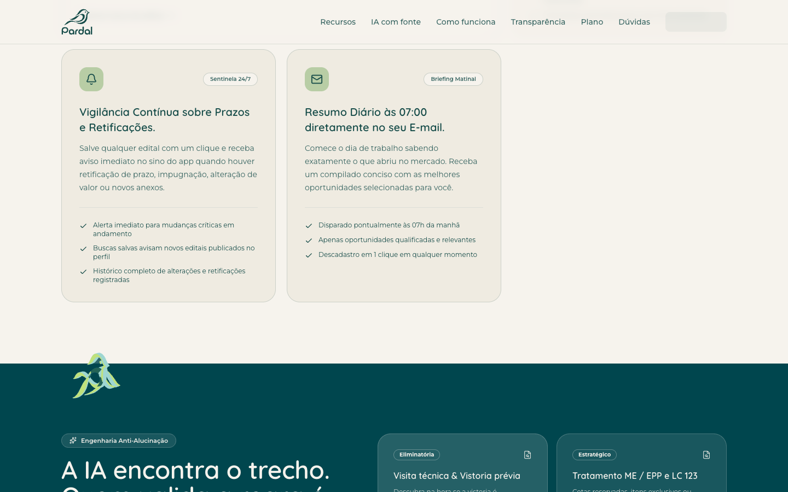            | 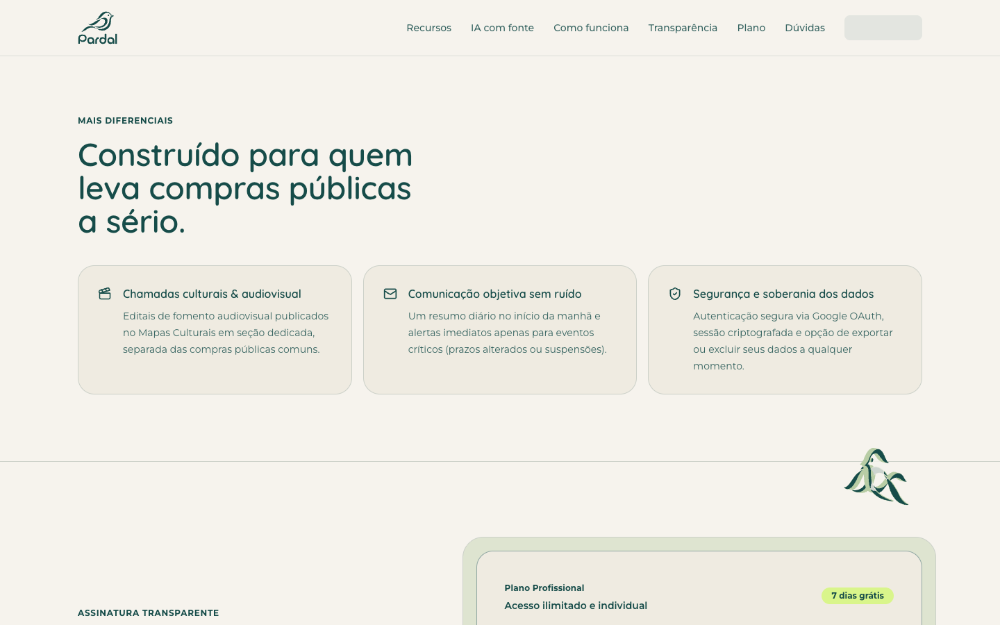            |
| Planando de asas abertas          |           | 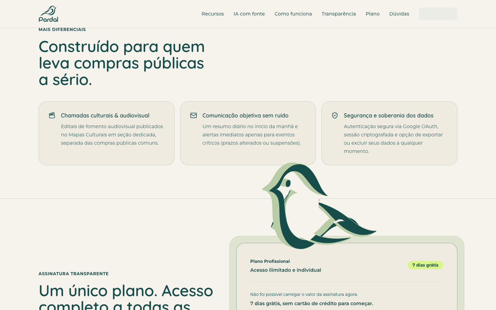          |
| Perto da câmera                   | 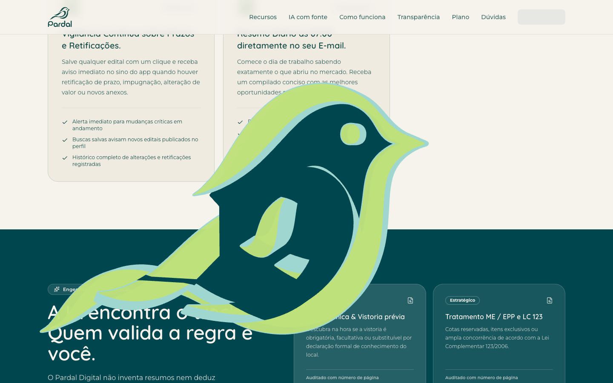                | 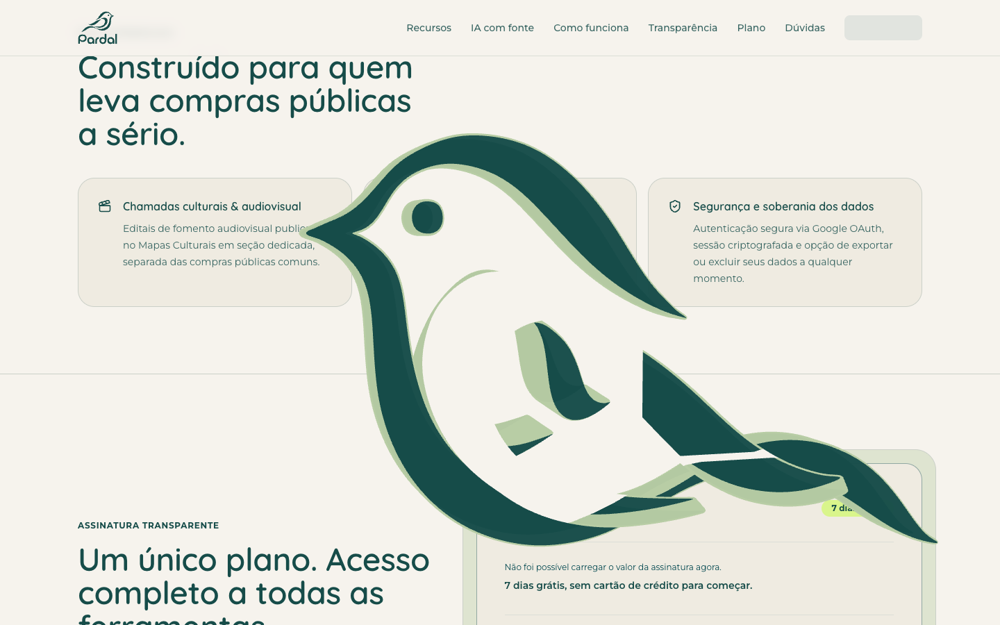                |
| Cortina de cor                    | 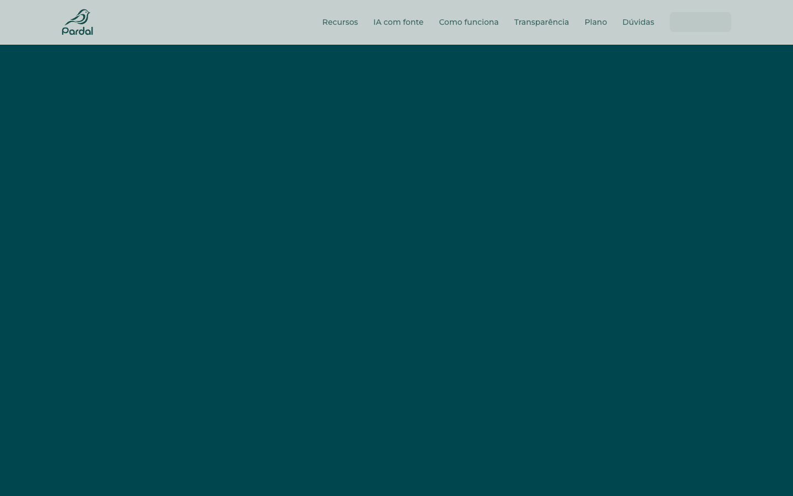            | 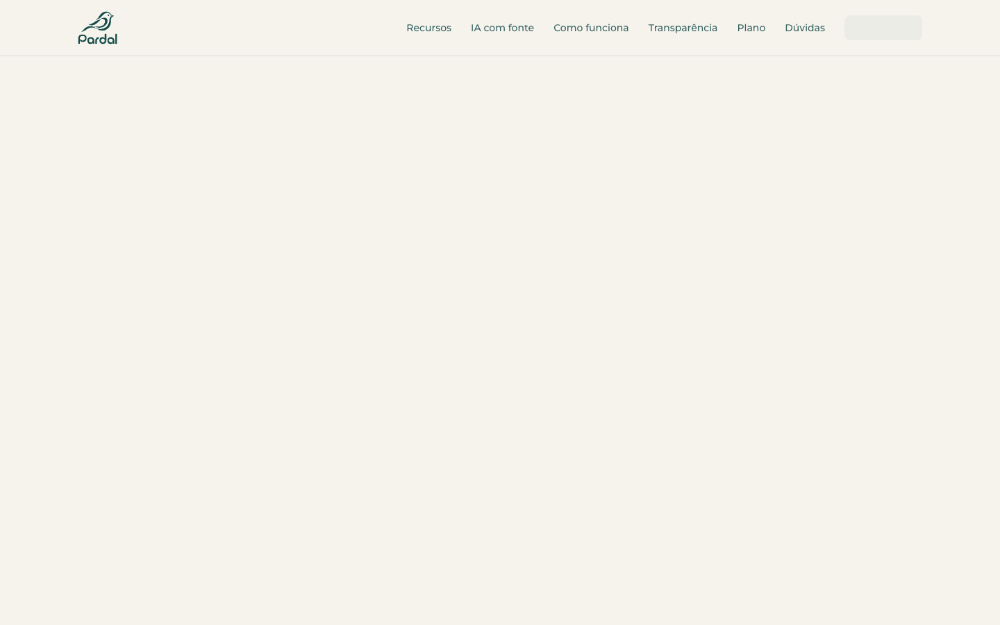            |
| Mesmo ponto do planeio, na subida | 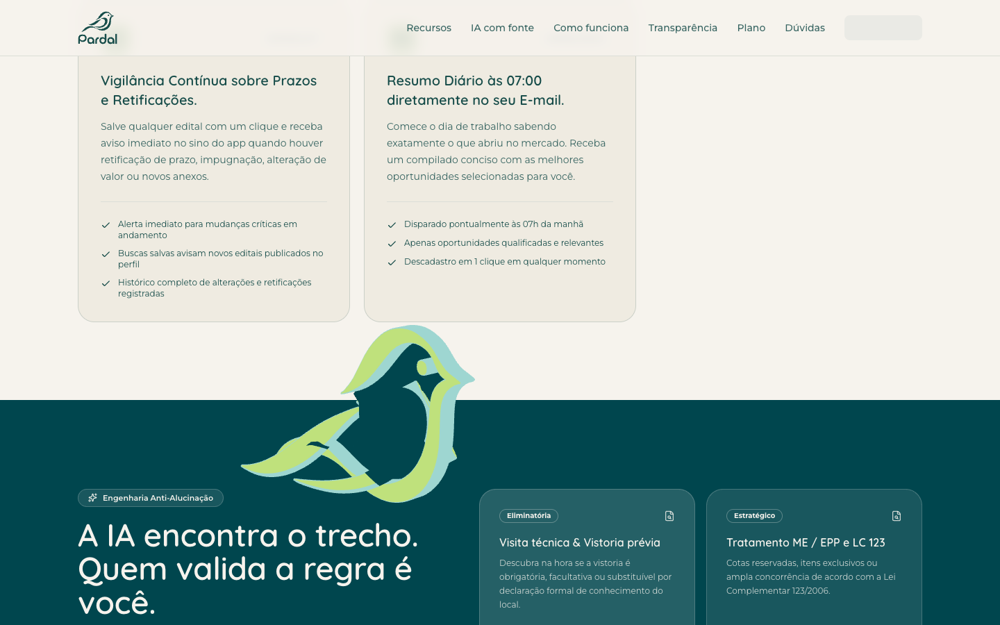 | 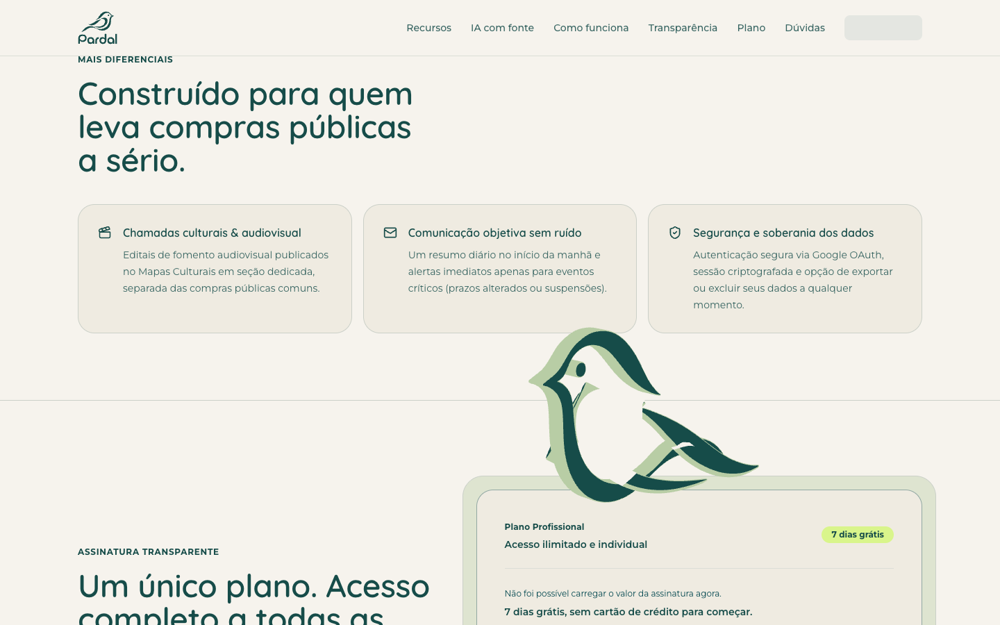 |

| Repouso no topo                 | Topo depois de ir ao fim e voltar                      |
| ------------------------------- | ------------------------------------------------------ |
| 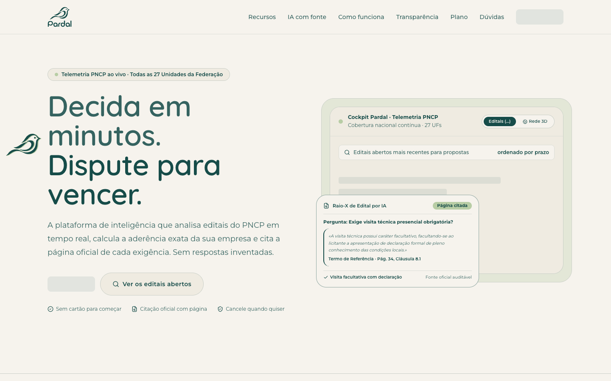 | 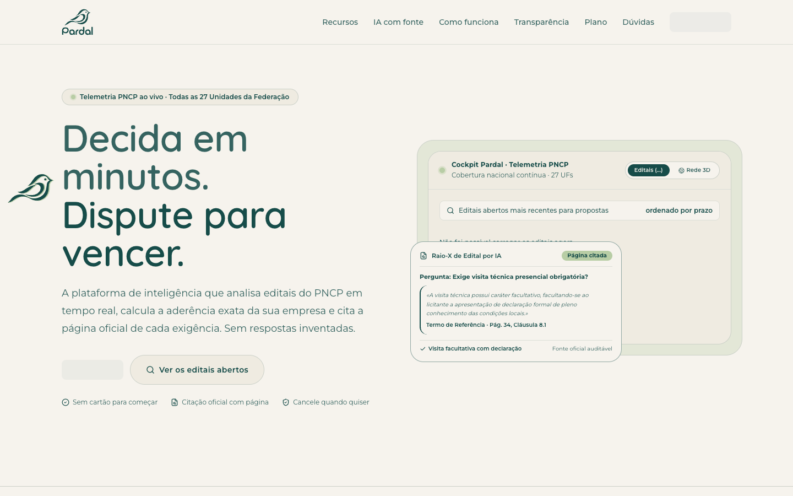 |

| `prefers-reduced-motion` (pose estática)              | Tela estreita (390 × 844) durante o momento |
| ----------------------------------------------------- | ------------------------------------------- |
| 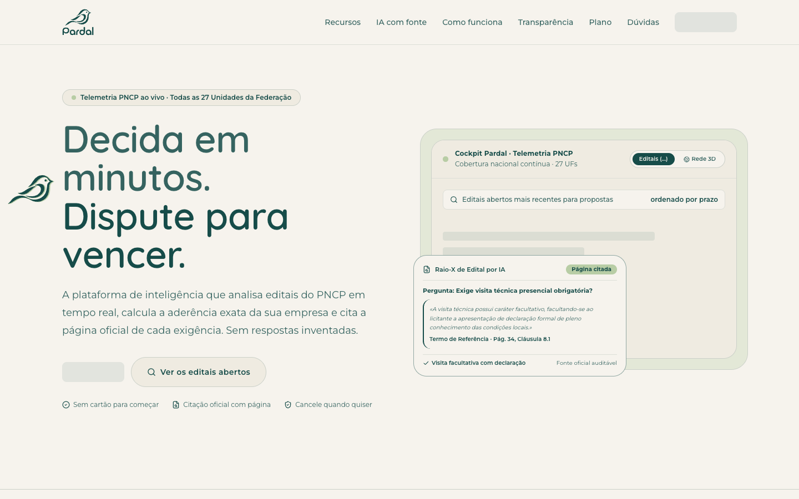 | 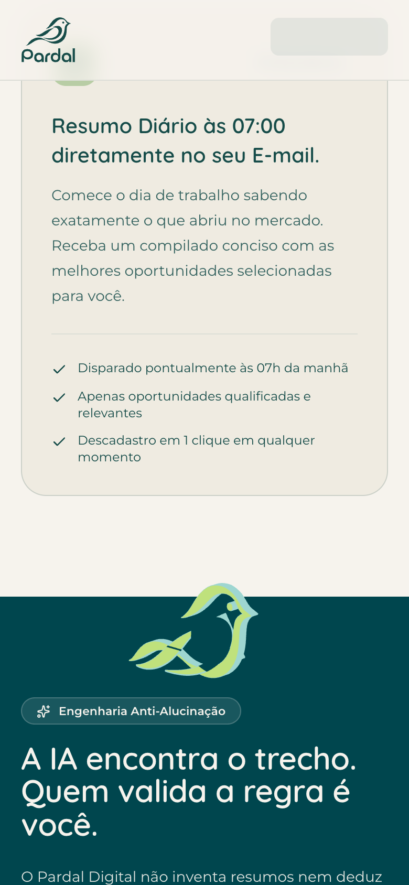    |

Repouso com a página rolando (ampliado 4×): os dois primeiros quadros são durante a rolagem, o terceiro logo depois dela e o último com a página parada.

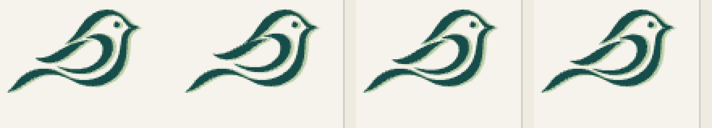

## De onde vêm as asas

O `pardal-silhueta.svg` já traz a asa separada do corpo, no grupo `asa` (`asa-curva` + `asa-pena`). Nada foi redesenhado:

- a asa de perto é o próprio grupo `asa`; a de longe é uma cópia espelhada no plano do corpo. Dobradas, as duas coincidem e o desenho é o logo oficial;
- o pivô é o ombro, na frente da `asa-curva` (`WING_ROOT` em `pardal-flight-3d.tsx`, em unidades do viewBox);
- a asa abre girando para fora do plano do logo, bate em torno do eixo do corpo e torce em torno da própria envergadura. As duas usam a mesma fase, espelhada.

## Medições

| O que                                                                | Resultado                                |
| -------------------------------------------------------------------- | ---------------------------------------- |
| `requestAnimationFrame` por segundo, página parada fora dos momentos | 0                                        |
| Idem, parada no meio de um momento                                   | 60                                       |
| Idem, parada com a tela coberta pela cortina                         | 0                                        |
| Idem, com `prefers-reduced-motion` no ponto do momento               | 0                                        |
| Tempo de quadro durante o voo (mediana / p95 / máximo)               | 16,7 / 16,7 / 16,8 ms                    |
| Chunk `pardal-flight-3d` (carregado sob demanda)                     | 85,47 → 88,10 kB (gzip 36,92 → 38,16 kB) |
| Chunk `three.module`                                                 | sem alteração                            |

O tempo de quadro foi medido em um Apple M4; não houve medição em um notebook mais modesto. A cena tem um pardal extrudado e um plano de cor, sem sombras nem pós-processamento.

## Limites conhecidos

- A aproximação continua ocupando 35% da altura da tela de rolagem (contrato de `pardal-flight-scroll.ts`, coberto pelos testes existentes). Com a roda do mouse isso são cerca de três passos; o voo suaviza cada passo em vez de saltar, mas é curto. Alongar o momento exige mudar esse contrato.
- No fim da aproximação o pardal cresce até cobrir a tela e passa sobre o texto das duas seções por um trecho curto da rolagem (cerca de 13% da altura da tela). Antes disso ele voa pela faixa vazia da fronteira entre as seções.
- Em repouso a opção foi asa dobrada com a página parada e uma leve erguida da asa só enquanto a página rola, para não manter um loop de animação fora dos momentos.
