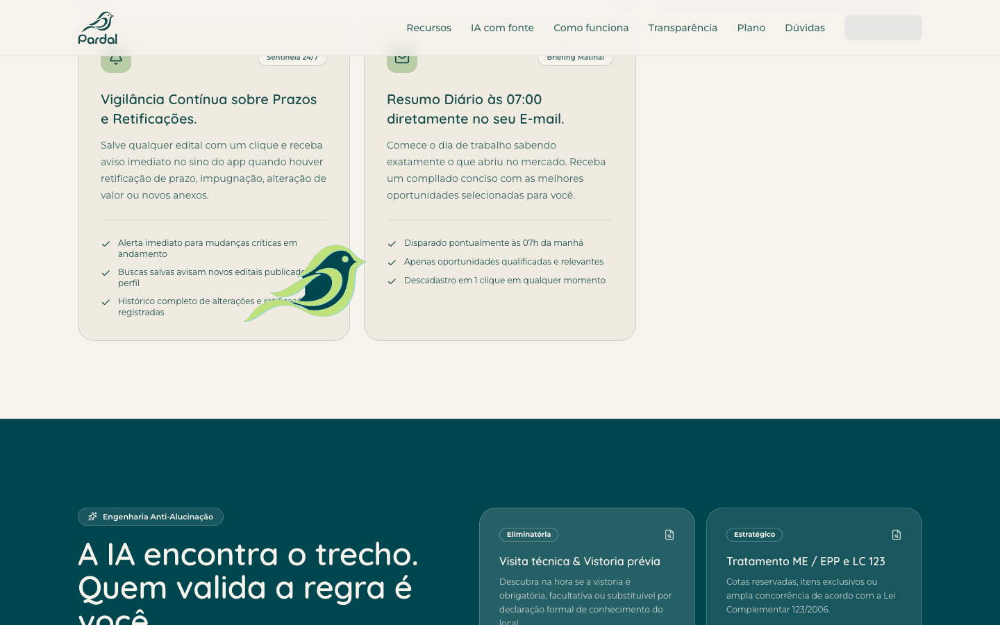
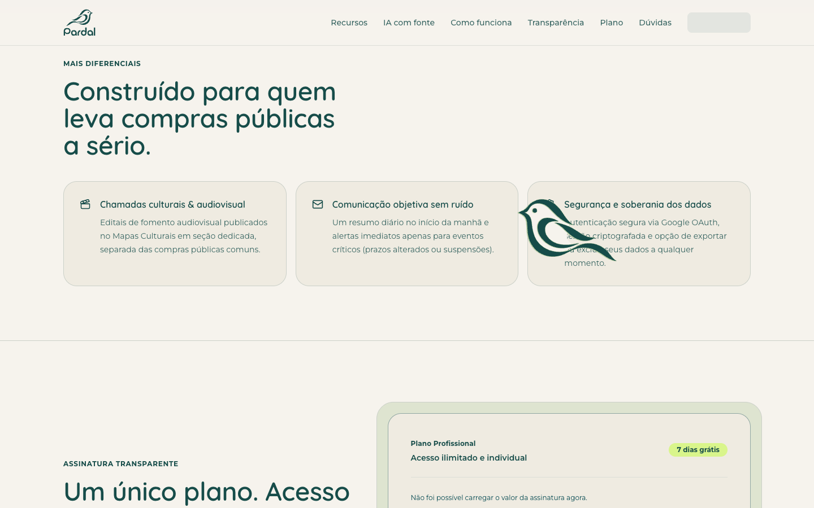
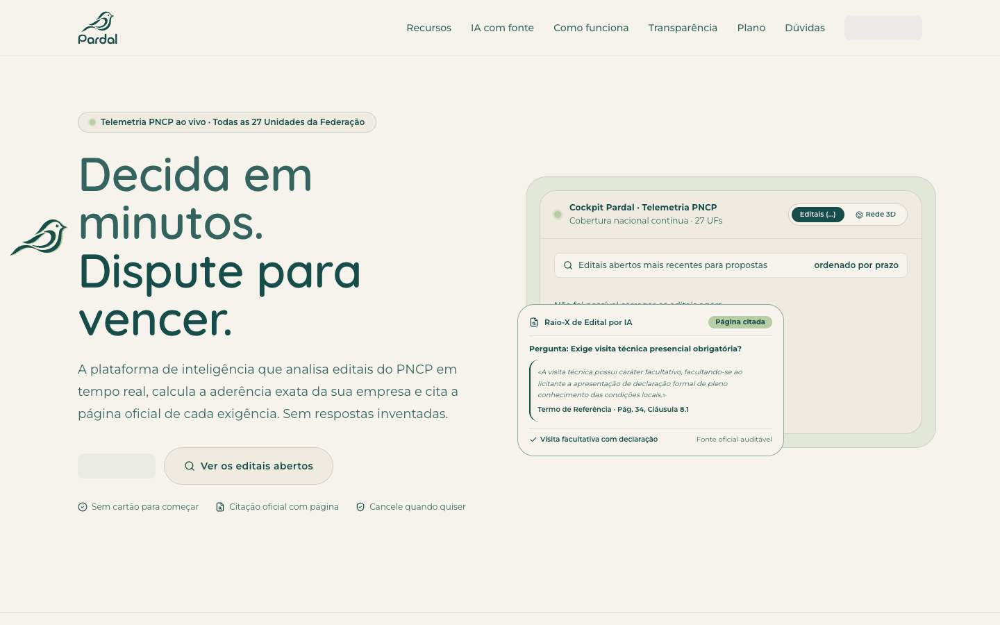

# Evidências — momentos bidirecionais do pardal

Capturas feitas em `vite preview`, viewport de 1440 × 900, com Playwright 1.64 e Chromium (canal Google Chrome). O roteiro abriu a home no topo, percorreu `#ia` e `#plano` até o fim da página, voltou pelos mesmos pontos intermediários e terminou novamente em `scrollY = 0`.

| Momento | Descida                                   | Subida                                  |
| ------- | ----------------------------------------- | --------------------------------------- |
| IA      |        |        |
| Plano   |  |  |

## Topo

| Carregamento inicial                 | Após ir ao fim e voltar                        |
| ------------------------------------ | ---------------------------------------------- |
|  |  |
